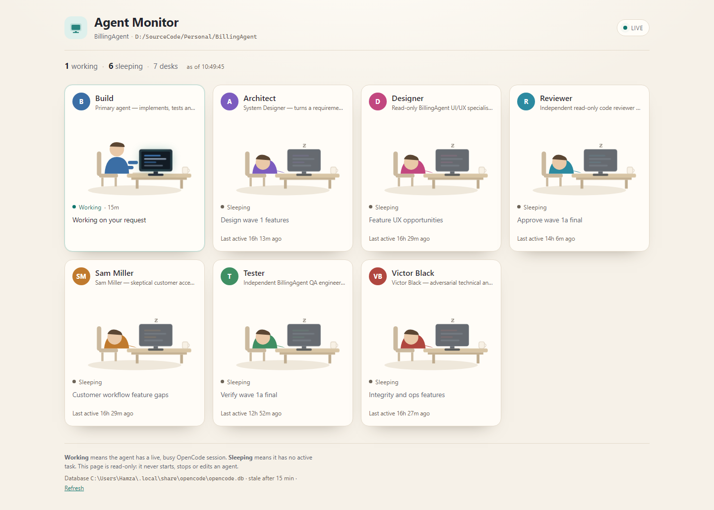

# OpenCode Agent Monitor (OCAM)

A local web app that turns OpenCode activity into an office floor. Every agent
in the current project gets a desk: it is **working** when it has a live task,
and **sleeping** when it does not.



It is a read-only dashboard: it never starts, stops or messages an agent, and it
never writes to the OpenCode database. On loopback it can also edit the project's
agent markdown files and add new agents.

> Unofficial community tool. Not affiliated with the OpenCode project.

## Install

Requires **Node.js 24** or newer (it uses the built-in `node:sqlite` and runs
TypeScript directly). There are no dependencies.

```powershell
npm install --global @wiseprogress/opencode-agent-monitor
ocam
```

Or run it without a global install:

```powershell
npx @wiseprogress/opencode-agent-monitor
```

Then open <http://127.0.0.1:4420>.

Run it against a specific project:

```powershell
ocam "D:\SourceCode\Personal\BillingAgent"
```

`ocam --help` lists every option. Use the **Project** selector in the header to
switch to any project in the OpenCode database.

## Run from source

```powershell
cd D:\SourceCode\Personal\AgentMonitor
npm start
```

On Windows you can also double-click **`start.cmd`**, which starts the server in
its own window and opens the browser.

By default it watches the current folder and the OpenCode database at
`~/.local/share/opencode/opencode.db`. Use the **Project** selector to switch to
any other project in that database; the default path is just the starting point.

## What a desk shows

- **Avatar and name** for every agent in `.opencode/agents/`, plus `Build`.
- **Working** — the agent's current task (the session title), an elapsed timer,
  step progress from its todo list, and a typing animation.
- **Sleeping** — its last task and how long ago it was active, with the monitor
  dimmed and a sleeping pose.
- **Coordinating** — when an agent's own session is waiting on a sub-agent, its
  desk still shows working and names the sub-agent task.
- **Visitor** — a built-in helper (`explore`, `general`, `plan`, …) appears in a
  dashed card only while it has a live task.
- **Edit** — a link on each file-backed desk opens its agent editor.
- A summary line: how many agents are working and sleeping, and when the view
  was last refreshed.

The page updates live over Server-Sent Events. With JavaScript disabled it still
renders fully and refreshes itself every 15 seconds.

## How "working" is decided

The database stores, per session, when it became busy and when it went idle.

| Condition | Desk |
|---|---|
| `time_busy > time_idle` and activity within the stale window (15 min) | Working |
| Idle marker is newer than the busy marker | Sleeping |
| Busy, but nothing has updated for more than 15 minutes | Sleeping (stale) |
| Agent's own session is idle but a child session is working | Working — coordinating |
| Agent has no sessions in this project | Sleeping — no task yet |

The freshness check uses the latest session update, not the start of the busy
period, so a long build or test run stays marked as working.

Task text comes from the session title. For a generic title such as
`Main Session (Build Agent)`, the in-progress todo step is used instead.

## Four views and project switching

The dashboard has four views, switchable from the header:

- **Desks** — the compact card view (`?view=desks`).
- **Mind map** — a radial mind map with an agent list on the left. Build (or a
  project hub when there are several root agents) sits at the center; direct
  sub-agents sit on the first ring, their sub-agents on the next ring, and so
  on. Each coordinator owns an angular wedge, so deeper agents stay grouped
  under their parent. The left-hand cards show each agent's task and status and
  provide the Edit action; sleeping agents are grayscale. Working agents glow
  and connector links brighten. When a coordinator assigns work, it walks along
  the link to the sub-agent; when a sub-agent finishes, it walks back to its
  parent. Motion respects `prefers-reduced-motion`.
- **Org structure** (default) — a formal reporting chart. Coordinators sit above their
  direct reports, nested reports sit below their manager, and connectors make
  the chain of command explicit. Each card carries status, task, progress and
  an Edit action; sleeping agents are grayscale. This view updates live but
  does not animate walking. Larger, keyboard-focusable cards expose full task
  text on focus. Search highlights matching names, roles and tasks; zoom,
  fit-to-window and actual-size controls help navigate larger teams. Reporting
  lines refresh when the hierarchy changes.
- **All projects** (`?view=projects`) — one card per OpenCode project with its
  working and sleeping counts, a status bar and the agents that are active
  right now. It refreshes every five seconds and links into each project's org
  chart. OpenCode's synthetic global project is skipped.

A **Project** selector in the header switches between every project in the
OpenCode database. The selection is carried in `?project=<project-id>`, so
links, edits and live updates stay on the same project. Each project's agents
are read from its own `<worktree>/.opencode/agents` folder (the configured
project can override this with `--agents`).

The Mind map, Org structure and All projects views are static without
JavaScript, but still readable and refreshed every 15 seconds.

## Edit and create agents

On a loopback bind address, every agent backed by a file gets an **Edit**
action in the Desks, Mind map and Org structure views, and the header has a
**New agent** action. The editor exposes:

- display name (Agent Monitor only)
- description / role
- mode (`primary`, `subagent`, `all`, or the OpenCode default)
- model
- color
- system prompt body

Only those frontmatter keys and the body are changed. Nested `permissions`,
`temperature`, `tools` and unknown frontmatter are preserved exactly. The agent
id is the markdown filename and cannot be changed from the editor.

Display names are stored in `.opencode/agents/.agent-monitor.json` so the
OpenCode markdown schema stays untouched. Before each save the previous file is
copied to `.opencode/agents/.agent-monitor-backups/` (the newest 20 are kept),
and saves are refused with `409` if the file changed on disk while the form was
open.

The built-in **Build** desk is not editable unless a real `build.md` exists.
Agent Monitor refreshes immediately after a save; a running OpenCode process may
need to reload or restart before it picks up the new configuration.

Editing is enabled by default only when bound to `127.0.0.1`, `localhost` or
`::1`. Use `--read-only` to disable writes entirely. Non-loopback binds are
always read-only.

## Options

```
ocam [project-path] [--port=4420] [--stale-minutes=15] [--refresh-ms=2000] [--read-only]
```

| Flag | Environment variable | Default |
|---|---|---|
| project path (positional) | `MONITOR_PROJECT` | current folder |
| `--project=<path>` | `MONITOR_PROJECT` | same as above |
| `--db=<path>` | `MONITOR_DB` | `~/.local/share/opencode/opencode.db` |
| `--port=<number>` | `MONITOR_PORT` | `4420` |
| `--host=<address>` | `MONITOR_HOST` | `127.0.0.1` |
| `--stale-minutes=<n>` | `MONITOR_STALE_MINUTES` | `15` |
| `--refresh-ms=<n>` | `MONITOR_REFRESH_MS` | `2000` |
| `--agents=<dir>` | `MONITOR_AGENTS_DIR` | `<project>/.opencode/agents` |
| `--read-only` | `MONITOR_READ_ONLY` | off |

Paths may start with `~` to mean your home directory. `start.cmd` opens the
browser at the configured `MONITOR_HOST` and `MONITOR_PORT` when running from
source.

The server binds to localhost only by default, and editing is refused on
non-loopback addresses. Session titles and prompts can contain sensitive text,
so do not expose it on a network interface without adding authentication.

## Endpoints

- `GET /` — the default Org structure view. Add `?view=desks`, `?view=mindmap`
  or `?view=projects`; add `?project=<id>` to open another project.
- `GET /api/state` — the current project snapshot as JSON (`?project=<id>` for
  another project).
- `GET /api/projects` — totals and per-project summaries for the All projects
  view.
- `GET /events` — Server-Sent Events stream for the selected project
  (`?project=<id>`).
- `GET /health` — database, desk and editing status for scripts.
- `GET /agents/new` — create form.
- `GET /agents/<id>/edit` — edit form.
- `POST /agents` — create an agent.
- `POST /agents/<id>` — save an agent.

## Tests

```powershell
npm test
```

66 tests cover project resolution, project switching and the all-projects
overview, busy/idle/stale transitions, archived
sessions and archived projects, parent roll-up, todo progress, visitor desks,
roster parsing, configuration precedence, agent-file parsing and patching,
editing routes, CSRF and loopback write gating, the radial mind map, the
organizational structure view, duration formatting, HTML escaping, schema
degradation and the no-JavaScript fallback.

## Structure

```
dist/           bundled npm CLI, generated by npm run build
src/cli.ts      CLI entry: help, version and server start
src/config.ts   flags, environment, defaults, loopback detection
src/agents.ts   agent markdown parsing, validation, aliases, safe writes
src/db.ts       read-only SQLite access and project resolution
src/state.ts    roster discovery and working/sleeping snapshot
src/render.ts   server-rendered HTML, CSS, SVG scene, SSE client, editor pages
src/interactive.ts  the optional radial mind map
src/org.ts      the optional organizational structure chart
src/overview.ts all-projects summary model and sorting
src/projects.ts the all-projects dashboard
src/server.ts   HTTP server, polling, SSE, health, project switching, agent editing routes
test/           configuration, agent-file, fixture-database and route tests
```

The database schema is detected at startup (`session_v2` first, then the older
`session` table), and columns that do not exist are treated as null so a schema
change degrades instead of crashing.

## Troubleshooting

- **`listen EACCES`** — Windows has reserved the port (4317–4416 is a common
  reserved range). Start with another port, e.g. `ocam --port=4420`.
- **"No OpenCode project matches"** — pass the project folder explicitly:
  `ocam D:\SourceCode\Personal\OtherProject`.
- **Everything is asleep while OpenCode is running** — the monitor reads the
  same user profile's database. Check the `Database` path in the footer.
- **Broken page after a schema change** — run `/health`; the banner on the page
  includes the underlying error.
- **No Edit links / "Editing is disabled"** — the server is bound to a
  non-loopback address or started with `--read-only`. Bind to `127.0.0.1` and
  remove the flag.
- **"This agent file changed on disk"** — the file was edited outside Agent
  Monitor while the form was open. Reload the edit page and save again.
