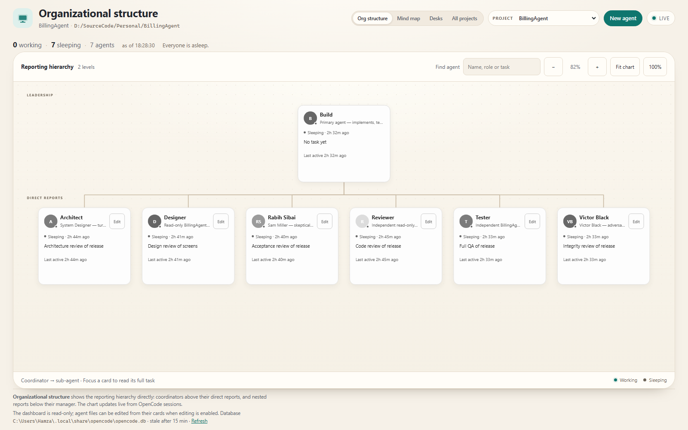
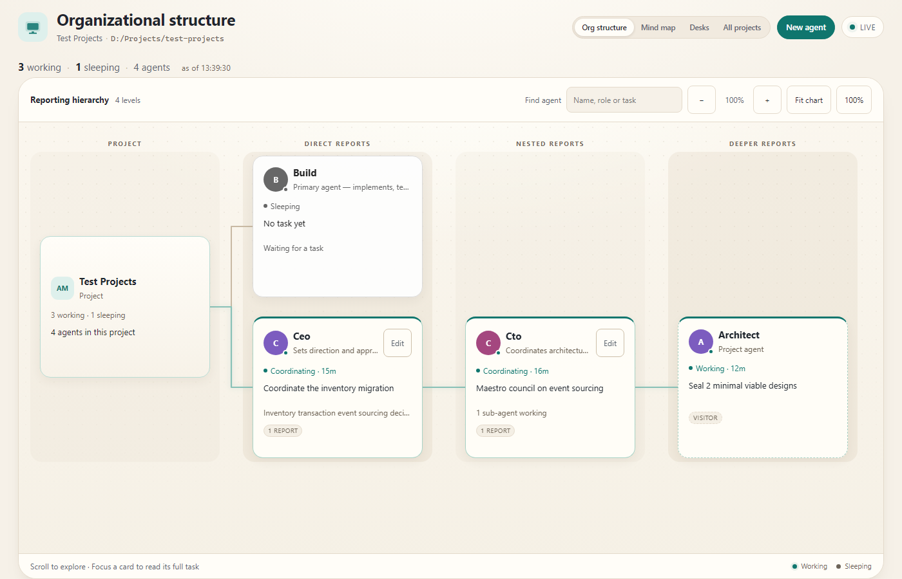
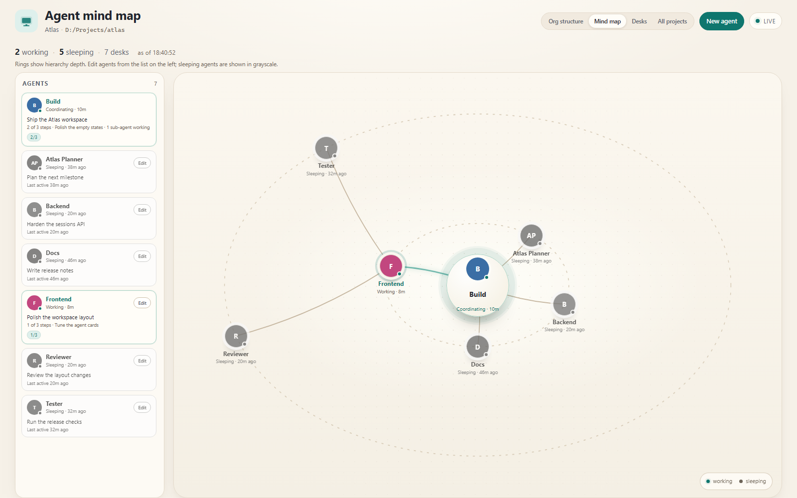
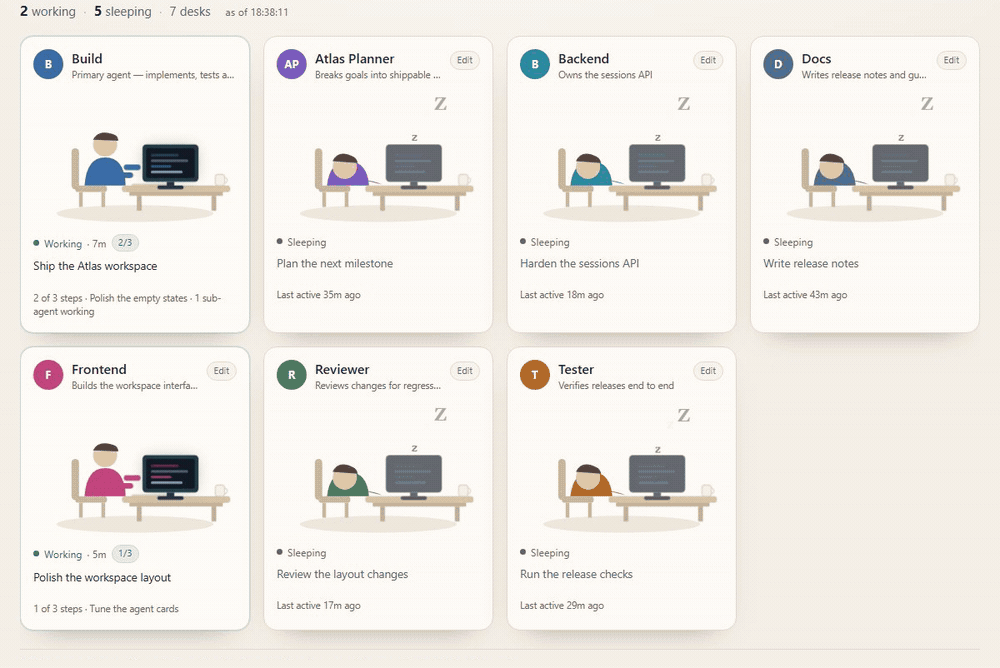

# OpenCode Agent Monitor (OCAM)

**Live visibility for every OpenCode agent, across every project.**

[](https://www.npmjs.com/package/@wiseprogress/opencode-agent-monitor)
[](https://www.npmjs.com/package/@wiseprogress/opencode-agent-monitor)
[](LICENSE)
[](https://nodejs.org)
[](https://github.com/WProgress/opencode-agent-monitor/stargazers)



OCAM is an unofficial, local-first dashboard for **OpenCode**. It reads your
local OpenCode database and turns agent sessions into a live view of who is
working, who is waiting, what they are doing, and how coordinators and
sub-agents relate to each other.

No cloud account. No telemetry. No writes to the OpenCode database.

> Unofficial community tool. Not affiliated with the OpenCode project.

## Why OCAM

- **See the whole team at once** — working, sleeping and coordinating.
- **Follow the reporting chain** — coordinators above their direct reports and
  nested sub-agents below them.
- **Switch between projects** — one dashboard for every OpenCode project in your
  local database.
- **Understand what is happening now** — current task, elapsed time, todo
  progress, and live updates over Server-Sent Events.
- **Stay local** — the database is opened read-only, and no data leaves your
  machine.
- **Edit safely when needed** — optional agent-file editing on loopback only.

## Quick start

### Requirements

- **Node.js 24 or newer**
- **OpenCode**, with the project opened at least once so its sessions exist in
  the local database

### Install

```powershell
npm install --global @wiseprogress/opencode-agent-monitor
```

Run it from the project you want to monitor:

```powershell
cd C:\path\to\your-project
ocam
```

Then open <http://127.0.0.1:4420>.

On macOS or Linux:

```bash
npm install --global @wiseprogress/opencode-agent-monitor
cd ~/code/your-project
ocam
```

Or run it without a global install:

```bash
npx @wiseprogress/opencode-agent-monitor
```

To choose the project explicitly, or use another port:

```powershell
ocam "D:\SourceCode\Personal\BillingAgent" --port=4421
```

## Views

### Org structure — default

A formal reporting chart. For shallow teams, coordinators sit above their direct
reports, nested reports sit below their manager, and elbow connectors make the
chain of command explicit. Sleeping agents are grayscale. Cards show status,
task, progress and an Edit action.

When a project has **three or more delegated levels**, the chart switches to
left-to-right reporting columns so the full chain stays legible instead of
shrinking into a thumbnail. Focus a card to trace its reporting line; unrelated
branches dim.




Use **Find agent** to filter by name, role or task, and the zoom controls to fit
large teams. On narrow screens the chart becomes an indented list, so deep
hierarchies stay readable without tiny text.

### Mind map

A radial view of delegation. The project hub — or the single root agent when the
project has one — sits at the center. Direct sub-agents sit on the first ring,
their sub-agents on the next, and so on. Each coordinator owns an angular wedge,
so deeper agents stay grouped under their parent.



Working agents glow, connector links brighten, and coordinators walk along their
links when assigning work. Motion respects `prefers-reduced-motion`.

### Desks

The original office view. Every agent gets a desk: typing when working, asleep
when not. Each card carries its last task and how long ago it was active.



*Working agents type, sleeping agents show `zzz`, and status changes arrive
without refreshing the page.*

### All projects

One card per OpenCode project, with working and sleeping counts, a status bar,
and the agents that are active right now. The view refreshes every five seconds
and links directly into each project’s org chart. OpenCode’s synthetic global
project is skipped.

## Project switching

The **Project** selector in the header lists every project in the OpenCode
database. The selection is carried in `?project=<project-id>`, so links, edits
and live updates stay on the same project.

Each project reads agents from its own `<worktree>/.opencode/agents` folder. The
project passed on the command line may override this with `--agents`.

## How “working” is decided

The database stores, per session, when it became busy and when it went idle.

| Condition | Desk |
|---|---|
| `time_busy > time_idle` and activity within the stale window (15 min) | Working |
| Idle marker is newer than the busy marker | Sleeping |
| Busy, but nothing has updated for more than 15 minutes | Sleeping (stale) |
| Agent’s own session is idle but a child session is working | Working — coordinating |
| Agent has no sessions in this project | Sleeping — no task yet |

The freshness check uses the latest session update, not the start of the busy
period, so a long build or test run stays marked as working.

Task text comes from the session title. For a generic title such as
`Main Session (Build Agent)`, the in-progress todo step is used instead.

## Safety and privacy

- The OpenCode database is opened **read-only**.
- The dashboard never starts, stops or messages an agent.
- Agent editing is available only on loopback (`127.0.0.1`, `localhost`, `::1`)
  and can be disabled with `--read-only`.
- Forms use a per-process CSRF token; cross-origin submissions are rejected.
- Agent edits preserve nested frontmatter, create a backup, and refuse stale
  writes.
- No analytics, telemetry or external requests are made by the dashboard.

## Compatibility and limitations

- **Node.js 24+** is required because the app uses `node:sqlite`.
- Intended for **local, single-user** use. There is no authentication layer for
  network hosting; do not expose it on a public interface.
- Agents are discovered from the project’s `.opencode/agents` directory. OpenCode’s
  built-in **Build** agent appears only when `build.md` exists or the project has
  at least one Build session; it is never invented for projects that do not use it.
- Sessions, tasks and todos come from the same user profile’s OpenCode database.
  Set `MONITOR_DB` or `--db` to use another database.
- Development and testing are primarily on Windows; macOS and Linux use the
  same commands and Node APIs.
- The view is an unofficial interpretation of OpenCode state. OpenCode schema
  changes are handled defensively, but future versions may need updates.

## CLI options

```text
ocam [project-path] [--port=4420] [--stale-minutes=15] [--refresh-ms=2000] [--read-only]
```

| Flag | Environment variable | Default |
|---|---|---|
| project path (positional) | `MONITOR_PROJECT` | current folder |
| `--project=<path>` | `MONITOR_PROJECT` | same as above |
| `--db=<path>` | `MONITOR_DB` | `~/.local/share/opencode/opencode.db` |
| `--port=<number>` | `MONITOR_PORT` | `4420` |
| `--host=<address>` | `MONITOR_HOST` | `127.0.0.1` |
| `--stale-minutes=<n>` | `MONITOR_STALE_MINUTES` | `15` |
| `--refresh-ms=<n>` | `MONITOR_REFRESH_MS` | `2000` |
| `--agents=<dir>` | `MONITOR_AGENTS_DIR` | `<project>/.opencode/agents` |
| `--read-only` | `MONITOR_READ_ONLY` | off |

Paths may start with `~` to mean your home directory.

## Development

```bash
git clone https://github.com/WProgress/opencode-agent-monitor.git
cd opencode-agent-monitor
npm install
npm test
```

Run from source:

```bash
npm start
```

Build the published CLI bundle:

```bash
npm run build
```

The bundle is written to `dist/` and is what npm installs. The source runs
directly on Node 24 without a build step.

### Endpoints

- `GET /` — the default Org structure view. Add `?view=desks`, `?view=mindmap`
  or `?view=projects`; add `?project=<id>` to open another project.
- `GET /api/state` — the current project snapshot as JSON (`?project=<id>` for
  another project).
- `GET /api/projects` — totals and per-project summaries for All projects.
- `GET /events` — Server-Sent Events stream for the selected project
  (`?project=<id>`).
- `GET /health` — database, desk and editing status for scripts.
- `GET /agents/new` and `GET /agents/<id>/edit` — agent editor pages.
- `POST /agents` and `POST /agents/<id>` — create and save agents.

## Testing

```bash
npm test
```

68 tests cover project resolution, project switching, the all-projects overview,
busy/idle/stale transitions, archived sessions and projects, parent roll-up,
todo progress, visitor desks, roster parsing, configuration precedence,
agent-file parsing and patching, editing routes, CSRF and loopback write gating,
the radial mind map, the organizational structure view, duration formatting,
HTML escaping, schema degradation, the no-JavaScript fallback, and the CLI.

## Contributing

Issues and pull requests are welcome. If OCAM is useful to you, a star helps
other OpenCode users find it.

Before opening a PR:

1. Run `npm test`.
2. Keep changes consistent with the existing server-rendered style.
3. Update the README or tests when behavior changes.

Please avoid posting tokens, database contents or other sensitive information in
public issues.

## License

[MIT](LICENSE) © wiseprogress

OpenCode Agent Monitor is an unofficial community project and is not affiliated
with or endorsed by the OpenCode project.
